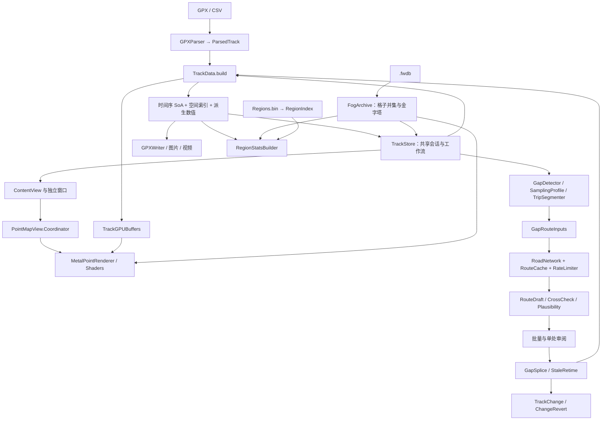

# GPXPointViewer 架构接手评估

日期：2026-10-28。范围：当前工作区的静态阅读。任务执行模型按登记为 `gpt-6-astra / ultra`。

## 1. 核心判断与证据边界

**这是一个围绕大规模轨迹数据优化的 macOS 原生单体应用，已经形成完整的查看、修整、审阅、导出链条。最应保留的是 SoA 数据流水线、版本化派生数据、路网结果与人工决定分离、落地前后证据留存；最需要收紧的是编辑事务的身份与依赖语义、统一的数据换代机制，以及 CPU/GPU 可变数据的所有权。**

不需要为了接手而全面重写。现有规模适合继续保持一个桌面应用、若干清晰的内部模块；渐进抽出工作流与数据契约，比按文件长度拆分或换架构框架更有收益。

本报告先读 README、设计文档、Tests/README，再核对指定的关键源码，并补读解析器、写出器、区域统计、着色器、应用入口和测试运行脚本。没有运行应用、构建、测试、联网服务或付费 API，没有修改产品源码。文中的性能数字若提到，只表示文档记载；没有把旧报告当作本次实测。

当前 `HEAD` 为 `b8927ed`，但工作区有大量已修改文件及未跟踪的核心模块，故 **本报告描述的是当前工作区，不是该提交可以独立复现的状态**。这是交接时首先应固定的基线条件；本任务没有执行提交、清理或回退。

下文“事实”来自当前源码；“静态风险”表示可从代码结构或具体路径推导、但本次未运行复现；“建议”表示后续可渐进实施的方向。

## 2. 产品目标与真正的系统边界

产品有三条主线：

1. **快速观察位置历史。** GPX/CSV 导入，点云、热力、迷雾、地球、时间筛选、多文件重叠与对比；核心约束是百万级数据下的载入、缩放、拾取和内存成本。
2. **有依据地修整轨迹。** 识别断档、回放点与乱跳，取道路/铁路草稿，人工审阅后插点、删点或改时间，保留修改记录并导出。路线引擎与风险分提供依据，不能替用户证明“这就是当时走过的路”。
3. **从轨迹或存档统计探索。** `.fwdb` 解锁格、地区归属、探索面积与回放；格子数据和带时间的轨迹是两个不同数据源。

这是会话型工具。应用级 `TrackStore` 被主窗口、找不同、批量补点、修改记录和地区统计窗口共同使用；不是每个窗口拥有独立文档。源码依据：[应用入口](/Users/zyx/Documents/GPXPointViewer/GPXPointViewer/GPXPointViewerApp.swift:117)、[共享窗口](/Users/zyx/Documents/GPXPointViewer/GPXPointViewer/GPXPointViewerApp.swift:127)。

导入是格式归一化而非原文件往返编辑。`ParsedTrack` 主要保留 lat/lon/ele/time、来源和精度摘要、文件归属；没有保存完整 XML、厂商扩展或原始 GPX 分段结构。正常导出重写这些核心字段，增量导出另有分段与合成点标记。源码依据：[解析模型](/Users/zyx/Documents/GPXPointViewer/GPXPointViewer/GPXParser.swift:25)、[写出接口](/Users/zyx/Documents/GPXPointViewer/GPXPointViewer/GPXWriter.swift:24)。

“本地应用”也不代表所有路径离线：本地解析、几何计算、地区统计、`.fwdb`、Quick Look 可离线；底图、OSRM/Valhalla、Overpass、部分逆地理编码依赖外部服务。外部瓦片显示与导出还不完全同源：快照走 `MKMapSnapshotter`，外部底图按设计回退到 Apple 对应底图，见 [地图设计](/Users/zyx/Documents/GPXPointViewer/docs/map-sources.md:22)。

## 3. 模块与依赖图

这是逻辑分层，不是已经存在的独立编译模块。主 target 仍以一组 Swift 文件直接组合，测试 runner 也直接列出产品源码编译。

| 模块 | 当前拥有的责任 | 边界评价与证据 |
|---|---|---|
| `GPXParser` / `GPXWriter` | 格式识别、双趟并行解析、写出 | 输入输出边界较清楚；解析器用“起始标签归属块”保持计数与写入一致。[解析规则](/Users/zyx/Documents/GPXPointViewer/GPXPointViewer/GPXParser.swift:10) |
| `TrackData` / `GeoCompute` | 归一化轨迹、投影、速度、颜色、时间与空间索引、拾取 | 面向数据布局，适合当前性能目标；但模型直接依赖 SwiftUI 设置和 Metal 缓冲构建。[模型](/Users/zyx/Documents/GPXPointViewer/GPXPointViewer/TrackData.swift:427)、[构建出口](/Users/zyx/Documents/GPXPointViewer/GPXPointViewer/TrackData.swift:569) |
| `TrackStore` | 全应用状态、加载、模式、编辑、批量取路、审阅、统计、导出、窗口行为 | 目前最主要的耦合集中点，约 4386 行。它同时是状态容器、领域工作流和 UI 协调者。[声明](/Users/zyx/Documents/GPXPointViewer/GPXPointViewer/TrackStore.swift:72)、[批量关窗](/Users/zyx/Documents/GPXPointViewer/GPXPointViewer/TrackStore.swift:4027) |
| `ContentView` / 专用窗口 | 用户界面、绑定、操作入口、覆盖层 | 主视图约 2820 行；已经主动隔离高频观察对象，值得保留。[局部覆盖层](/Users/zyx/Documents/GPXPointViewer/GPXPointViewer/ContentView.swift:13) |
| `PointMapView.Coordinator` | MapKit/AppKit 桥接、手势、拾取、视角切换、绘制节拍、导出接线 | 每个视图自己的协调器，主文件约 3557 行；承担多个相机与生命周期子系统。[协调器](/Users/zyx/Documents/GPXPointViewer/GPXPointViewer/PointMapView.swift:190) |
| `MetalPointRenderer` / `Shaders.metal` | GPU 缓冲、空间裁剪、点/线/热力/迷雾/地球/3D 热力与离屏渲染 | 硬件相关实现集中，采用 RTC 与实例化；优化路径带有明确语义限制。[渲染入口](/Users/zyx/Documents/GPXPointViewer/GPXPointViewer/MetalPointRenderer.swift:646) |
| `GapFill` / `FillPlausibility` | 画像、检测、取路输入、插值、改时、拼接与规则评估 | 已形成大量可离线复用的纯算法；文件内部仍有多个不同阶段，适合按输入输出契约渐进抽出。[候选](/Users/zyx/Documents/GPXPointViewer/GPXPointViewer/GapFill.swift:54)、[评估](/Users/zyx/Documents/GPXPointViewer/GPXPointViewer/FillPlausibility.swift:158) |
| `RoadNetwork` / `BatchFill` | 服务适配、限流、几何后处理、两路比较、批量模型和缓存 | 外部 I/O 与几何算法目前同文件；批量真正的调度 actor 在 TrackStore 内，而不在 BatchFill。[限流](/Users/zyx/Documents/GPXPointViewer/GPXPointViewer/RoadNetwork.swift:255)、[批量调度](/Users/zyx/Documents/GPXPointViewer/GPXPointViewer/TrackStore.swift:3582) |
| `ChangeLog` | 会话修改、路网证据、按值还原与审阅数据 | 避免依赖易变下标是正确方向，但目前不是完整的事务依赖模型。[修改模型](/Users/zyx/Documents/GPXPointViewer/GPXPointViewer/ChangeLog.swift:25)、[还原实现](/Users/zyx/Documents/GPXPointViewer/GPXPointViewer/ChangeLog.swift:108) |
| `FogArchive` / `RegionIndex` / `RegionStats` | 独立格子来源、空间归属、统计 | 静态数据与计算逻辑较独立；地区结论也受数据版本及吸附规则影响。[格子模型](/Users/zyx/Documents/GPXPointViewer/GPXPointViewer/FogArchive.swift:19)、[统计](/Users/zyx/Documents/GPXPointViewer/GPXPointViewer/RegionStats.swift:60) |
| Quick Look / Thumbnail | Finder 预览、缩略图 | 两个独立扩展，共用轻量解析/形状代码，没有把主应用整套渲染数据搬进扩展。[预览](/Users/zyx/Documents/GPXPointViewer/GPXQuickLook/PreviewViewController.swift:25)、[缩略图](/Users/zyx/Documents/GPXPointViewer/GPXThumbnail/ThumbnailProvider.swift:15) |

## 4. 四条关键数据流

### 4.1 导入 → 计算 → 显示

`TrackStore.load` 获取 security-scoped 文件访问，后台映射读取文件，`parseMany` 跨文件统一分块两趟解析；再为每个文件切出 `LoadedFile.parsed` 留底，合并后构建显示轨迹。不是从磁盘到 GPU 全程零拷贝：解析直写消除了分块结果合并拷贝，但文件切片、排序、派生数组和 GPU 缓冲仍各有内存成本。[导入](/Users/zyx/Documents/GPXPointViewer/GPXPointViewer/TrackStore.swift:919)、[切片留底](/Users/zyx/Documents/GPXPointViewer/GPXPointViewer/TrackStore.swift:957)、[显示重建](/Users/zyx/Documents/GPXPointViewer/GPXPointViewer/TrackStore.swift:790)。

`TrackData.build` 先按时间归一化：有效时间占据 `[0, timedCount)`，缺时间点排尾；已有序的多文件 runs 尝试归并，否则走全局排序。之后四个并行阶段分别计算投影链、速度、球面向量、抬升与边界，再建 Morton 空间索引、颜色和 GPU 缓冲。[构建流水线](/Users/zyx/Documents/GPXPointViewer/GPXPointViewer/TrackData.swift:493)、[排序](/Users/zyx/Documents/GPXPointViewer/GPXPointViewer/TrackData.swift:1093)。

发布新的 `TrackData.id` 后，协调器在 `sync()` 中领取缓冲、重置派生显示状态；时间过滤仅给出连续索引范围。几何换代和颜色换代分别用 `id`、`colorVersion` 表达，减少不必要的重建。[视图同步](/Users/zyx/Documents/GPXPointViewer/GPXPointViewer/PointMapView.swift:729)、[时间区间](/Users/zyx/Documents/GPXPointViewer/GPXPointViewer/TrackData.swift:1086)。

### 4.2 候选 → 草稿 → 风险 → 落地

检测层先依据采样画像区分时间空洞、过时时钟、乱跳簇，再组织行程及路由上下文；`GapRouteInputs` 把锚点、方向、外侧真实点、匹配轨迹、半径等打成可复用输入。公路走 OSRM/Valhalla，铁路取 Overpass 几何并在本地求路径。`RouteDraft` 明确区分原始几何与后处理几何，并保留来源、外推锚点、贴路距离、taper、道路步骤和隧道信息。[草稿契约](/Users/zyx/Documents/GPXPointViewer/GPXPointViewer/RoadNetwork.swift:174)。

普通批量模式由两个引擎 worker 分担候选；精确模式对同一候选取两份几何，不一致或只有一路成功则进入待选状态，不自动落地。**两个引擎共享 OSM 数据和若干后处理，交叉一致只能降低选路分歧，不能排除共同偏差。** 这是额外设置 `FillPlausibility` 的原因。[并行工作流](/Users/zyx/Documents/GPXPointViewer/GPXPointViewer/TrackStore.swift:3360)、[比对模型](/Users/zyx/Documents/GPXPointViewer/GPXPointViewer/RoadNetwork.swift:1869)。

风险评估用最终将落地的合成点、原始路线和上下文计算规则分；缺失证据不扣分，因此 `low` 不是概率意义上的“安全”。当前 high 为 `risk > 50`，medium 从 20 开始；`taperExcess` 的重扣门槛是 **18 m**，补点少于 **4 个** 时改用最终折线顶点采样。不要把历史提案的 20 m 当作当前实现。[阈值](/Users/zyx/Documents/GPXPointViewer/GPXPointViewer/FillPlausibility.swift:75)、[等级](/Users/zyx/Documents/GPXPointViewer/GPXPointViewer/FillPlausibility.swift:149)、[稀疏点处理](/Users/zyx/Documents/GPXPointViewer/GPXPointViewer/FillPlausibility.swift:176)。

批量预览和真正落地共用 `landingJob`，评估也借此生成相同口径的点；这是非常重要的正确性基础。`StaleRetime` 保留可信出口点的位置，只调整时间；`GapSplice` 拼接到新数组，再完整重建 TrackData。高风险默认取消勾选，用户仍可明确采用；它是审核默认值而非不可绕过的禁令。[共用落地计划](/Users/zyx/Documents/GPXPointViewer/GPXPointViewer/TrackStore.swift:4069)、[评估口径](/Users/zyx/Documents/GPXPointViewer/GPXPointViewer/TrackStore.swift:2308)、[默认处理](/Users/zyx/Documents/GPXPointViewer/GPXPointViewer/TrackStore.swift:3433)。

### 4.3 编辑 → 修改记录 → 还原/导出

套索先建立预删除 mask 和逐步撤销历史，执行时才改变数据。补点落地按每处候选建立 `TrackChange`，保存 added/removed/anchors，以及两路草稿、选择、比对与风险。修改之后同步单文件留底，再发布新轨迹，避免切换模式时复活旧数据。[落地记录](/Users/zyx/Documents/GPXPointViewer/GPXPointViewer/TrackStore.swift:2661)、[删除留底同步](/Users/zyx/Documents/GPXPointViewer/GPXPointViewer/TrackStore.swift:4363)。

按值还原用 `(time, lat, lon)` 的 Double 位模式认点；改时间表现为旧点删除、新点增加。这个模型适合在下标变化后找到点，但不等于稳定的“点实例身份”，也尚未表达记录之间的依赖，详见风险 R1。[点键](/Users/zyx/Documents/GPXPointViewer/GPXPointViewer/GapFill.swift:1687)。

修改记录仅属于本次会话，常规换数据时会清空；没有发现把整个编辑会话持久化为项目文件的实现。该边界应向接手者说明，不能把“可还原”理解成跨重启恢复。[换代清理](/Users/zyx/Documents/GPXPointViewer/GPXPointViewer/TrackStore.swift:1090)。

### 4.4 `.fwdb` / GPX → 探索与区域

`.fwdb` 是格子位图来源，不转换为伪 GPX 点轨迹。解析区块后去重合并，构建多级聚合金字塔；渲染按视口和层级取实例，统计使用 0 级格子。多存档取集合并集，避免重复面积。[模型及时间语义](/Users/zyx/Documents/GPXPointViewer/GPXPointViewer/FogArchive.swift:20)、[金字塔](/Users/zyx/Documents/GPXPointViewer/GPXPointViewer/FogArchive.swift:227)。

GPX 的探索格来自每点所在格及符合连续性规则的相邻段光栅化。视觉迷雾半径、平滑边缘与真实解锁格统计是不同口径，不能用画面白色面积反推统计面积。[GPX 解锁格](/Users/zyx/Documents/GPXPointViewer/GPXPointViewer/TrackData.swift:1011)、[格子面积](/Users/zyx/Documents/GPXPointViewer/GPXPointViewer/TrackData.swift:988)。

`RegionIndex` 懒加载内置二进制，通过 1° 候选格、整数几何判断、大环纬度分带和每个计算任务自己的 0.01° 缓存加速。统计先归属最细地区，再沿父链汇总；点数/天数与格数/面积是两套指标，未归属部分显式保留。到访日期按本机时区解释，不是每个点当地时区。[索引](/Users/zyx/Documents/GPXPointViewer/GPXPointViewer/RegionIndex.swift:49)、[局部缓存](/Users/zyx/Documents/GPXPointViewer/GPXPointViewer/RegionIndex.swift:486)、[统计口径](/Users/zyx/Documents/GPXPointViewer/GPXPointViewer/RegionStats.swift:62)。

## 5. 并发与缓存

### 并发模型

| 边界 | 当前机制 | 接手时应保留的条件 |
|---|---|---|
| UI/共享会话 | `TrackStore` 和主地图协调器为 `@MainActor` | 状态发布在主 actor；避免在 SwiftUI 更新周期同步发布设置。[状态中心](/Users/zyx/Documents/GPXPointViewer/GPXPointViewer/TrackStore.swift:72) |
| 大数据计算 | `Task.detached` 包裹工作，内部 `DispatchQueue.concurrentPerform` 分块或分阶段 | 共享输入只读，写入分区互不重叠；不能把 `@unchecked Sendable` 当作编译器已证明安全。[构建临时结果](/Users/zyx/Documents/GPXPointViewer/GPXPointViewer/TrackData.swift:586) |
| 路网 HTTP | 全局 `RateLimiter` actor 按 host 单一在途；结束后至少等默认 1.05 s，Overpass 路径用 2 s；429/5xx 共用冷却 | 检查/占位不可跨 await；醒来重查；取消不计网络故障。源码顶部“1.2 s”注释与默认参数不同，应以执行代码为准。[限流实现](/Users/zyx/Documents/GPXPointViewer/GPXPointViewer/RoadNetwork.swift:283) |
| 批量分工 | `BatchCoordinator` actor 原子分配候选与可用引擎，失败停用在该轮保持 | 引擎失败、无路线、取消必须区分；命中缓存不能改变服务器健康。[队列](/Users/zyx/Documents/GPXPointViewer/GPXPointViewer/TrackStore.swift:3582) |
| 过期结果 | 批量/候选/地区/存档并集等使用 generation、trackID、请求状态 | 各路径覆盖不一致，见 R2；取消只能节约资源，版本检查才保证发布正确。 |
| 绘制节拍 | 一次性变化 runloop 合并；交互用 displayLink，静止约 0.35 s 暂停 | 高频渲染/悬停/比例尺/覆盖层独立观察，避免整个视图每帧重算。[节拍](/Users/zyx/Documents/GPXPointViewer/GPXPointViewer/PointMapView.swift:1018)、[小状态](/Users/zyx/Documents/GPXPointViewer/GPXPointViewer/TrackStore.swift:75) |

工程当前使用 Swift 5 语言模式；源码出现 Swift 并发标注，不表示已经通过 Swift 6 完整隔离检查。[工程设置](/Users/zyx/Documents/GPXPointViewer/GPXPointViewer.xcodeproj/project.pbxproj:583)。

### 缓存分层

| 缓存/派生物 | 键或生命周期 | 评价 |
|---|---|---|
| `RouteCache` | 完整路由输入，包括来源、economy、锚点、方向、trace、半径、portal、通行侧；换文件清空 | 不包含点距、勾选等 UI 决定，设计合理；只缓存完整草稿与确定性无路，传输失败/取消/partial 不缓存。当前无容量上限，长期会话需关注。[键](/Users/zyx/Documents/GPXPointViewer/GPXPointViewer/BatchFill.swift:242)、[缓存](/Users/zyx/Documents/GPXPointViewer/GPXPointViewer/BatchFill.swift:291) |
| `OverpassCache` | 包含查询 bbox 的结果，最多 32 份 | bbox 缓存必须按查询语义分实例，不能把铁路判段、隧道叠加不同查询混用。[实现](/Users/zyx/Documents/GPXPointViewer/GPXPointViewer/BatchFill.swift:336) |
| 外部瓦片 | URLCache；失败瓦片短期冷却 | 与路线缓存独立，成功结果遵守 HTTP 缓存头；瓦片健康汇总避免冲掉路由诊断。[瓦片实现](/Users/zyx/Documents/GPXPointViewer/GPXPointViewer/MapSources.swift:160) |
| `TrackData` 派生计算 | 几何以 track UUID 换代；颜色以 colorVersion 更新 | 重建昂贵但语义直接；可避免增量维护大量互相关联数组的错误。 |
| 地区报告/存档并集 | trackID/fwdbVersion + 模式；generation 拒绝旧结果 | 已有明确作废与取消，是通用异步作业值得复用的模式。[地区任务](/Users/zyx/Documents/GPXPointViewer/GPXPointViewer/TrackStore.swift:457)、[并集](/Users/zyx/Documents/GPXPointViewer/GPXPointViewer/TrackStore.swift:235) |
| 审阅轨迹 | trackID + 项内容键；构建中标记 pending，结束再补算 | 对 UI 稳定性有帮助；键需要覆盖真实几何、选择与改时变化，不能只看点数。[审阅构建](/Users/zyx/Documents/GPXPointViewer/GPXPointViewer/TrackStore.swift:2981) |
| `RegionIndex.Assigner` | 单个统计任务的局部格缓存 | 边界单元逐点计算，避免粗格中心把边界两侧混为一谈；静态索引可共享，局部缓存不共享写入。 |

## 6. 必须明确守住的不变量

1. **数组契约：** lat/lon/ele/time 与所有每点派生数组同长；可选 fileID 为空或同长；排序搬运必须同步所有字段。底层大量使用裸指针，破坏此契约不是普通显示错误。[ParsedTrack](/Users/zyx/Documents/GPXPointViewer/GPXPointViewer/GPXParser.swift:25)、[fileID 重排](/Users/zyx/Documents/GPXPointViewer/GPXPointViewer/TrackData.swift:1154)。
2. **时间契约：** 有限时间前缀非递减，缺时间在尾部；`[start,end)` 筛选是索引区间，不允许在某条编辑路径留下乱序而绕过统一 build。[时间索引](/Users/zyx/Documents/GPXPointViewer/GPXPointViewer/TrackData.swift:1086)。
3. **坐标契约：** 内部与路网草稿以 WGS-84 表示，地图坐标转换只在边界。当前 `GeoCoord` 恒等，只是接口预留，不能宣称 GCJ-02 已处理。[坐标入口](/Users/zyx/Documents/GPXPointViewer/GPXPointViewer/GapFill.swift:18)。
4. **候选契约：** 下标仅对创建候选时的轨迹有效；落地前验证 trackID、A/B 下标与时间值；批量作业按区间排序并避免重叠。[批量落地守卫](/Users/zyx/Documents/GPXPointViewer/GPXPointViewer/TrackStore.swift:4027)、[计划守卫](/Users/zyx/Documents/GPXPointViewer/GPXPointViewer/TrackStore.swift:4073)。
5. **预览契约：** 预览、风险评估、落地使用相同插点、保留点、改时和锚点扩展口径。改变一处规则时不能只修 UI 预览。[共同计划](/Users/zyx/Documents/GPXPointViewer/GPXPointViewer/TrackStore.swift:4069)。
6. **原始证据契约：** `rawCoords` 是裁剪后、trim/taper 前的路线；不能用后处理后的 coords 冒充它，否则自检会拿自己作标准。[草稿字段](/Users/zyx/Documents/GPXPointViewer/GPXPointViewer/RoadNetwork.swift:195)。
7. **人工作业契约：** 待选项不自动落地；自动重算不能覆盖明确手选；风险默认勾选与真正落地条件分开。`willLand` 是最终统一入口之一。[批量模型](/Users/zyx/Documents/GPXPointViewer/GPXPointViewer/BatchFill.swift:48)。
8. **来源/留底契约：** 单文件编辑后必须同步 `LoadedFile.parsed`；换数据源必须清除旧候选、审阅派生、比较与统计结果。这里任何遗漏都会让某个窗口看到旧世界。[apply](/Users/zyx/Documents/GPXPointViewer/GPXPointViewer/TrackStore.swift:1068)。
9. **渲染语义契约：** 时间顺序与空间顺序不能随意替换。半透明叠放、时间/文件着色、回放、文件显隐都约束 LOD 去重与裁剪优化。当前渲染器显式限定格首点去重适用条件。[限制](/Users/zyx/Documents/GPXPointViewer/GPXPointViewer/MetalPointRenderer.swift:708)。
10. **统计契约：** `.fwdb` 格子取并集、父子汇总不重复计数、未归属显式保留；`.fwdb` 文件 mtime 不能冒充逐格探索时间。[时间说明](/Users/zyx/Documents/GPXPointViewer/GPXPointViewer/FogArchive.swift:26)、[统计模型](/Users/zyx/Documents/GPXPointViewer/GPXPointViewer/RegionStats.swift:23)。

## 7. 优先风险及其实际含义

### R1：修改记录能描述差异，但尚不足以保证有依赖操作的任意还原

**静态风险，优先验证。** `ChangeRevert.apply` 把所选变更的 added 合并为 Set，从当前轨迹删掉匹配点，再无条件插回所有 removed；没有按逆操作顺序处理，也没有消去所选记录之间的中间状态。[实现](/Users/zyx/Documents/GPXPointViewer/GPXPointViewer/ChangeLog.swift:114)。

可直接推导的例子：第一步补入 P，第二步删除 P，当前已无 P；“全部还原”把第一步 P 放进 dropKeys，同时把第二步 P 放进待恢复列表。当前轨迹没有 P 可删，但恢复列表仍会插回 P，留下原始轨迹并不存在的中间合成点。`revertAllChanges` 确实把全部未还原记录交给这条实现。[调用入口](/Users/zyx/Documents/GPXPointViewer/GPXPointViewer/TrackStore.swift:2942)。

另外，点键不含海拔和实例序号，同一 time/lat/lon 的重复点会一起命中 Set；无时间点的 originalIndex 还原在多次修改后本来就只承诺近似，源码已注明。[键语义](/Users/zyx/Documents/GPXPointViewer/GPXPointViewer/ChangeLog.swift:8)、[近似边界](/Users/zyx/Documents/GPXPointViewer/GPXPointViewer/ChangeLog.swift:111)。

**建议：** 先冻结现有产品承诺：整批撤销、全部还原、选择性还原各自应满足什么，再以有依赖的编辑链验证。全部还原可通过逆序应用或对操作差异进行正确合成处理；选择性还原则必须明确与后续依赖记录的关系。先解决语义，暂不引入复杂持久化事件系统。

### R2：异步作业的过期保护不统一

**源码事实 + 未运行的竞态风险。** 批量、地区、存档并集有 generation；`rebuildDisplayTrack` 的后台完成却直接 `apply`，`load` 完成直接 `ingest`，`closeFile`/`clearTrack` 没有统一使这些作业失效。比较轨迹完成只检查仍为 compare 且文件数为 2，未核对具体文件身份。[无世代完成路径](/Users/zyx/Documents/GPXPointViewer/GPXPointViewer/TrackStore.swift:790)、[关闭文件](/Users/zyx/Documents/GPXPointViewer/GPXPointViewer/TrackStore.swift:751)、[比较完成](/Users/zyx/Documents/GPXPointViewer/GPXPointViewer/TrackStore.swift:647)。

当前 `isLoading` 和界面交互屏蔽会降低触发概率，但不是所有入口共享的底层保证；多个窗口、钩子或后续新入口会让这个差异扩大。可能后果是较早的重建覆盖较新的文件集合，或关闭后旧结果重新出现。本次未声称已在用户操作中复现。

**建议：** 用一套轻量会话版本/作业 token 包住加载、显示重建、编辑提交和比较构建；完成发布时验证“输入版本仍为当前”，同时保存可取消 task。作业取消与状态换代集中到一处，不依赖每个按钮各自记得做。

### R3：共享 GPU 颜色缓冲缺少显式的在途所有权契约

**静态风险，需 GPU 压力验证。** `updateColors` 对当前 `.storageModeShared` 颜色缓冲直接 memcpy，并同步改写 Morton 颜色副本。绘制通常 commit 后仅 `waitUntilScheduled`，并非等待 GPU 完成。代码对可见索引表使用三帧环形缓冲，却没有对颜色采用同样的版本/完成交接。[原地写色](/Users/zyx/Documents/GPXPointViewer/GPXPointViewer/MetalPointRenderer.swift:475)、[提交路径](/Users/zyx/Documents/GPXPointViewer/GPXPointViewer/MetalPointRenderer.swift:1125)、[索引环形缓冲](/Users/zyx/Documents/GPXPointViewer/GPXPointViewer/MetalPointRenderer.swift:510)。

主线程串行只能保证 CPU 调用顺序，不能自动证明前一帧 GPU 已读完；频繁换色、灰显、闪烁等情形值得专门核验。建议明确“新版本颜色缓冲替换旧版本”或“GPU 完成后复用”的边界；不建议直接以主线程逐帧等待完成来掩盖问题。

### R4：时间序点集不是轨迹拓扑，连续性目前主要靠启发式恢复

**已确认的数据模型限制。** `ParsedTrack` 不保留原始 trk/segment ID，排序后按相邻时间点计算速度；轨迹线和迷雾的断点分别由时间/距离阈值推导。迷雾断点检查没有使用 fileID；着色器里的 fileID 主要负责显隐，也没有把不同文件的边界视为天然断点。[解析字段](/Users/zyx/Documents/GPXPointViewer/GPXPointViewer/GPXParser.swift:25)、[速度](/Users/zyx/Documents/GPXPointViewer/GPXPointViewer/GeoCompute.swift:100)、[断点](/Users/zyx/Documents/GPXPointViewer/GPXPointViewer/TrackData.swift:770)、[显隐逻辑](/Users/zyx/Documents/GPXPointViewer/GPXPointViewer/Shaders.metal:855)。

因此，“输入文件/轨迹分段永远不会相连”不能由模型保证：不同段或交叠设备的相邻时间点如果恰好很近，仍可能被当作连续运动；速度、迷雾解锁格和线路语义都会受影响。当前重叠模式禁用部分编辑和轨迹线是在缩小风险面，并没有消除这个基础限制。

**建议：** 在下一次相关正确性修复中把“点的时间顺序”和“段内前后关系”写成独立契约，最小地保留来源/分段边界；不要求立刻更换 SoA 或全面重做数据模型。

### R5：状态组合和依赖方向提高了修改成本

**事实。** 当前状态中心用 `isLoading`、`fillApplying`、`keepChangeLog`、displayMode、batch phase、多个版本号共同决定 reset 语义；`apply()` 根据几个旁路标志决定清哪些记录。模型构建又直接调用 Metal，导致离线合成 runner 需要编入 renderer、Heat3D、PixelGlobe 等文件。[换代分支](/Users/zyx/Documents/GPXPointViewer/GPXPointViewer/TrackStore.swift:1068)、[runner 编译清单](/Users/zyx/Documents/GPXPointViewer/Tests/synth/runner/run_all.sh:18)。

**建议：** 首先将一次发布表达成明确原因与输入，例如“导入替换”“编辑提交”“还原提交”，集中列出各派生状态的保留/作废规则；再把批量流程、审阅数据和数据加载移到内部协作对象。避免只把同一个巨大类拆到若干 extension 而保留全部隐式依赖。

### R6：性能瓶颈下一阶段更可能是峰值内存与重建成本

**结构推断，不是实测。** TrackData 同时保留原始四列、速度、双精度投影、RTC、球面向量、抬升、颜色、两份拾取 scratch、两类断点前缀与空间索引；GPU 另有时间序/空间序几何与颜色副本。比较、审阅、旧轨迹和新轨迹重建会叠加。统一内存不代表这些逻辑副本消失。[每点数组](/Users/zyx/Documents/GPXPointViewer/GPXPointViewer/TrackData.swift:434)、[拾取 scratch](/Users/zyx/Documents/GPXPointViewer/GPXPointViewer/TrackData.swift:855)、[GPU 空间副本](/Users/zyx/Documents/GPXPointViewer/GPXPointViewer/MetalPointRenderer.swift:158)。

“后台预建缓冲后主线程领养”是对大部分 GPU 数组成立的性能策略；但 `setData` 开头仍在主线程复制 lineBreakPrefix，重复领取也有兜底拷贝。报告与后续优化应描述具体免除了哪次复制，避免笼统“全程零拷贝”。[实际领取](/Users/zyx/Documents/GPXPointViewer/GPXPointViewer/MetalPointRenderer.swift:386)。

**建议：** 先测几个代表场景的峰值内存、构建墙钟和主线程停顿，再决定懒建什么、复用什么。保留完整重建作为正确性基线；没有数据之前不要为了“增量”引入难以维护的数组局部修补。

### R7：领域准确性存在必须公开保留的边界

- **地区归属是多数据源加裁决规则的产物。** 当前国家直属缝隙向一级吸附上限为 6000 m，再向二级为 3000 m；设计文档较早文字仍写 3 km。不能把规则吸附后的结果宣传为严格多边形包含。[实际规则](/Users/zyx/Documents/GPXPointViewer/GPXPointViewer/RegionIndex.swift:338)、[设计旧文字](/Users/zyx/Documents/GPXPointViewer/docs/regions-design.md:120)。
- **`.fwdb` 时间线是区块 mtime 的近似顺序。** 原始位图没有逐格时间，金字塔父块取最早子块代序；这一回放不能作为精确历史记录。[数据语义](/Users/zyx/Documents/GPXPointViewer/GPXPointViewer/FogArchive.swift:26)、[父代合并](/Users/zyx/Documents/GPXPointViewer/GPXPointViewer/FogArchive.swift:251)。
- **GCJ-02 尚未实现。** 可确认的是转换函数恒等；特定地区/底图实际偏移的范围需要单独环境验证，本任务没有联网核验。[挂点](/Users/zyx/Documents/GPXPointViewer/GPXPointViewer/GapFill.swift:18)。
- **低风险结果可能只是证据不足。** nil 指标不扣分，Valhalla/旧录音可能没有 tunnelShare；应维持“风险提示”的表述，不把分数当成置信概率。[指标约定](/Users/zyx/Documents/GPXPointViewer/GPXPointViewer/FillPlausibility.swift:37)。

已登记的地区数据、测试脚本计数、旧文档残留、GCJ-02、`.fwdb` 时间线等问题仍应以现有待办为入口，避免重复造一份无人维护的清单：[既有待办](/Users/zyx/Documents/GPXPointViewer/Tests/tasks/api/_backlog.md:42)。

## 8. 测试体系与本次没有证明的事情

现有可验证性是项目的优势：

- 合成数据覆盖格式、合法运动、设备伪影、静止噪声和规模退化，文档列 6 族 114 文件；期望来自生成时的已知事实，不应照现实现抄答案。[测试说明](/Users/zyx/Documents/GPXPointViewer/Tests/README.md:310)。
- 125 道断档考卷把“候选/取路/后处理/插点”接到已知答案，录制 HTTP 后离线重放；可用于拆模块时证明算法口径不变。[考卷说明](/Users/zyx/Documents/GPXPointViewer/Tests/README.md:363)。
- UI hook、假引擎、输入 dump 能覆盖取消、预览、勾选和窗口交互；这些比只单测几何函数更接近真实工作流。
- `RouteReplay` 位于 HTTP 传输边界；请求本身未改变时可以复用已有录音，适合长期回归。[回放设计](/Users/zyx/Documents/GPXPointViewer/GPXPointViewer/RouteReplay.swift:5)。

需要注意的限制：

1. 本次没有重新跑任何测试，不能据此声称当前工作区构建成功或回归全绿。
2. 考卷缺失录音记 `noRecording`，不算失败；“无失败”必须同时报告覆盖了多少题，不能忽略缺失分母。[判卷约定](/Users/zyx/Documents/GPXPointViewer/Tests/README.md:374)。
3. 当前合成 runner 的源码清单不包含 `ChangeLog.swift`；还原领域规则没有从该 runner 得到直接保护。抽查 `run_review_tests.py`：它先单独还原删除，再执行全部还原，未直接覆盖 R1 所说“两条相依记录都仍生效时一起还原”的序列；未据此断言其他所有测试都没有覆盖。[清单](/Users/zyx/Documents/GPXPointViewer/Tests/synth/runner/run_all.sh:18)、[UI 还原顺序](/Users/zyx/Documents/GPXPointViewer/Tests/ui/run_review_tests.py:71)。
4. `run_suite.sh` 是运行脚本集合，不自动涵盖所有 `run_*.py`；地区统计脚本未列入该集合，已有待办记录。[当前清单](/Users/zyx/Documents/GPXPointViewer/Tests/ui/run_suite.sh:19)。
5. 历史性能数据、旧测试报告和主应用编译通过，都不能证明 GPU 在途缓冲所有权或所有多窗口竞态正确。这两类问题应有针对性的压力和操作序列验证。

## 9. 渐进接手顺序

以下是维护现有行为的建议，不是已执行的改动，也不增加新产品功能。

| 次序 | 最小工作包 | 完成标准 |
|---|---|---|
| 1 | 固定当前工作区基线和源码/数据版本，保留现有结果与运行说明 | 新接手者知道“这份代码”是哪份；不把未跟踪模块当作不存在 |
| 2 | 明确编辑/还原语义，验证并修正 R1 | 补后删、改时后删、连续覆盖、重复值、无时间点等组合符合约定；全部还原能回到相应初始状态 |
| 3 | 统一数据会话版本、取消与完成发布条件 | 慢加载、连关文件、模式切换、双窗口操作不能让旧结果覆盖新状态 |
| 4 | 收紧 CPU/GPU 可变资源交接 | 换色/灰显在 GPU 持续繁忙时仍一致，且不以每帧同步等待牺牲交互 |
| 5 | 抽出纯数据构建与 GPU 资源准备边界 | 算法 runner 无需依赖无关渲染模块；主应用仍可后台预建 GPU 资源 |
| 6 | 按工作流抽出加载、批量、审阅协调对象 | TrackStore 保留 UI 可观察状态和明确命令，状态换代规则可独立阅读与验证 |
| 7 | 在已有正确性任务中补足分段/来源连续性契约，并维护准确性文档 | 时间排序、段内邻接、显隐与统计互不混淆；文档与执行阈值一致 |

建议拆模块时先搬纯输入/输出逻辑和测试，再逐步移动所有权；不要同时调整几何阈值、改异步调度、换渲染布局。当前最有价值的回归资产是同一套输入在重构前后的候选、路由输入、落地计划与差异记录可以逐项比较。

## 10. 按问题寻找入口

| 遇到的问题 | 首读位置 |
|---|---|
| 导入慢、内存高、时间筛选异常 | `TrackStore.load/rebuildDisplayTrack` → `GPXParser.parseMany` → `TrackData.build/sortByTimeIfNeeded` |
| 平移卡顿、点飘、颜色/LOD 不一致 | `PointMapView.Coordinator.sync/performRedraw` → `MetalPointRenderer.render` → `Shaders.metal`，同时区分 CPU 等待与 GPU 时间 |
| 某个断档没被检出或锚点不对 | `SamplingProfile` → `GapDetector` → `GapRouteInputs`，先比输入 dump 再看路网 |
| 两路一致仍补偏 | `RouteDraft.rawCoords`、`PortalDrift`、trim/taper、`FillPlausibility`；一致性不是准确性证明 |
| 预览与落地不同 | `landingJob`、`StaleRetime`、`keptInnerPoints`、`assessBatchItem` 的输入是否相同 |
| 撤销/还原后点数或来源异常 | `performFills` / `performDeletion` 的记录 → `ChangeRevert.apply` → `LoadedFile.parsed` 同步 |
| 地区数值与另一应用不一致 | 先核对数据源、分区层级、时间口径，再看 `RegionIndex.lookupMicro/Assigner` 和吸附规则 |
| `.fwdb` 回放时间不可信 | `FogArchive.genTimes/levelGens`；先确认区块 mtime 是否保留，不把存档同步史当作逐格探索史 |

本任务交付文件为本报告与同目录 `progress.md`；没有安装应用、生成构建产物或改变用户轨迹。
