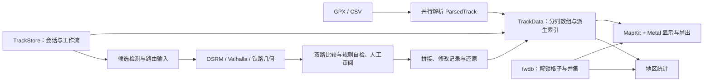

# GPXPointViewer 接手记录 · 2026-10-28

这次接手已梳理 Claude 开发历史、当前工作区架构和代理调用机制。结论是：保留现有面向大规模轨迹的数据管线，先明确编辑与异步任务的正确性边界，再逐步拆分工作流。没有必要为了换开发代理而重写应用。

本次只新增协作规则、调查报告、调用记录及一个小型 DeepSeek 诊断脚本。未修改产品源码，未构建、启动或安装应用，未执行公共路网请求。产品测试结论均明确区分历史记录和本轮验证。

## 阅读入口与本次分工

| 工作 | 派发模型 / 强度 | 完整材料 |
|---|---|---|
| 架构、数据流、不变量与渐进接手顺序 | GPT-6 Astra / ultra | [架构报告](../Tools/agents/records/2026-10-28-handover/architecture/output.md) |
| Claude 原聊天、开发沿革、用户要求、最后中断点 | GPT-6.1 Sol / ultra | [历史调查](../Tools/agents/records/2026-10-28-handover/history/output.md) |
| 调用路由、日志、预算、错误状态与恢复机制 | GPT-6.1 Sol / ultra | [独立审查](../Tools/agents/records/2026-10-28-handover/invocation-audit/output.md) |
| 合成文件读取与可核对答案 | DeepSeek V4.1 Flash 服务别名 / max | [实际结果](../Tools/agents/records/2026-10-28-handover/deepseek-smoke-r3/result.json)、[独立复核](../Tools/agents/records/2026-10-28-handover/deepseek-smoke-r3/independent-verification.json) |
| 整合与关键源码核对 | 主代理 | [核验说明](../Tools/agents/records/2026-10-28-handover/verification.md) |

当前规则见根目录 [AGENTS.md](../AGENTS.md)，新增任务总账见 [AGENT_LOG.md](../Tools/agents/AGENT_LOG.md)。所有任务在派发前登记，完整任务书、进度、结果和失败尝试均在项目内保存。原生子代理工具接受了指定模型/强度并完成任务；它未提供独立的服务端模型回执或费用数据，相应字段保留 unknown/null。

## 项目的设计与结构

这是一个共享会话状态驱动的 macOS 原生单体，含主应用、Quick Look 预览和缩略图两个扩展。主要目标是快速查看百万级位置历史、有依据地修整轨迹，以及从轨迹/迷雾存档统计探索情况。

- **数据与性能。** `GPXParser` 两趟分块直写；`TrackData` 采用 SoA（每个字段一列）、时间排序、向量化投影/测速、空间索引与 RTC 坐标；Metal 做实例化、裁剪与 LOD。应保留这些契约。共享内存仍有初始缓冲复制及多份派生数组，不能笼统理解为全程零拷贝。
- **状态与界面。** `TrackStore` 是主窗口及多个工具窗口共用的 `@MainActor` 状态中心。高频悬停、帧率、比例尺已隔离到小观察对象。复杂性主要集中在它同时承担加载、编辑、取路、批量、审阅与取消等编排，而不只是文件较长。
- **补点。** 采样画像与候选检测 → 路由输入 → 草稿 → 双路比较/几何规则自检 → 人工决定 → 落地。预览、评估和提交共用落地计划是重要保证。OSRM/Valhalla 一致并不证明历史路径正确；`FillPlausibility` 是风险提示，尚未训练或安装本地 AI 模型。
- **数据来源。** `.fwdb` 以格子作为真实来源，不是假造一条 GPX。多存档取并集；显示平滑与统计面积不同口径。其回放时间只来自区块同步时间，不能当作逐格真实探索时间。地区统计依赖内置边界与归属规则。
- **文件语义。** GPX/CSV 导入是归一化，不是完整原文件往返编辑；XML 扩展与原始分段信息并未完整保留。修改记录属于当前会话，目前没有跨重启的完整编辑项目存档。

底层必须守住数组同长、有效时间有序、坐标边界明确、候选绑定对应轨迹版本、预览与落地同口径、原始路网证据不被后处理覆盖、半透明绘制顺序不被空间排序改变等不变量。详细源码行号和模块入口见 Astra 报告。

## Claude 之前如何开发

历史调查对本项目 **53 份顶层 JSONL、约 529 MB** 做了流式索引，去重并保存 115 条实质用户请求和 19 条关键 Claude 回应，保留原文件、行号与 UTC 时间；没有把系统通知当作人工需求。主要演进是：

1. 8 月：大数据查看、多文件模式、Quick Look、热力图、迷雾存档、回放/视频、CSV 与找不同。
2. 9 月：大文件渲染性能、空间索引/LOD、多轮独立审查；因代理额度中断形成“成功、失败、没做都必须记”的规则。
3. 10 月：断档检测与路网补点、采样自适应、铁路保守门槛、批量审阅、修改记录、四语本地化、地区统计、双路交叉验证、缓存与外部底图。
4. 最近：落地前规则自检、125 道离线考卷、阈值方案 B 及界面收尾。

开发闭环是“需求和设计 → 实现 → 核心探针/回归 → 针对本轮改动写自洽任务书 → DeepSeek 复测 → 主代理核实问题并修复 → 新一轮”。任务书与报告不覆盖，不能以“同前”代替准备和预期说明，也不为测试变绿随意改真值。

需要继承的是日志、可恢复性、关键测试核验、实际使用验证、公共服务串行和明确汇报分工。旧的 Fable/Opus 名单与“订阅紧张，优先消耗 Claude API”是当时安排，已被本次 Astra/Sol/DeepSeek 分工覆盖。DuckDB 学习任务和本应用开发是并列目标；用户要求学习练习亲手做，不代表禁止代理开发应用，也不代表批准把 DuckDB 或 nanoGPT 加进产品。

## 最后一次工作停在哪里

原聊天最后的完整证据表明，**10 月 28 日 14:12（Berlin）的安装链已报告完成**，其中五组钩子回归均 `FAILS: none`，随后 Claude 触发 Fable 额度上限。当前 `/Applications` 可执行文件的时间戳与该历史记录相符；本次没有重新验证其功能或证明它与全部当前源码完全一致。

阈值方案 B 当前实现用 **18 m** 重扣门槛，并在补点不足 **4 个**时按折线顶点采样。历史考卷报告正常题 pass 121/125，伪影 high 123/125，平行路 high 125/125；这是历史验证和有限数据覆盖，不是对所有输入的保证。

明确的交接缺口是 [第 4 轮 DeepSeek 复测任务书](../Tests/tasks/2026-10-28_loose_ends_threshold_r4.md)：已存在，但没有找到对应启动/完成报告。本轮没有替它运行产品 UI 测试。

旧 backlog 和 registry 不能整体当成现在的待办：Tests/README 的 19→25 已修；API 全部 10-28 到期的叙述已被后来新增额度记录推翻；8 条旧 Workflow 非 done 中有多项已经续跑或被后续审查覆盖。报告逐项区分，不盲目重跑。

## 调用实测与留档问题

DeepSeek 使用现有 `~/bin/claude-ds` 和既有认证，通过本地观测器只转发到 `api.deepseek.com/anthropic`；测试输入为合成文本，工具仅 Read。成功轮实际发出两次 `model=deepseek-flash`、`output_config.effort=max` 请求，均 HTTP 200；Read 返回文件内容，最终总数 17、保证同类数量 4、校验标记正确，CLI 成功终止。Sol 独立核对了原始事件；主代理又离线验证“仅有 Read 意图、没有成功工具结果”不能判通过，无需额外付费调用。

`deepseek-flash` 对应 V4.1 Flash 的产品映射依据 [DeepSeek 官方发布说明](https://www.deepseek.com/en/news/deepseek-v4-1-flash/)；`max` 参数依据 [官方思考模式说明](https://api-docs.deepseek.com/guides/thinking_mode/)。测试证明当前入口及 Read 往返可用，不代表所有工具/MCP/写入权限都已经验证，也不能从响应别名得到底层权重版本。

三次尝试分别保存：第一轮被沙盒阻止本地监听，未发 API；第二轮两次 HTTP 200 后本地观察器解析系统事件失败；第三轮修复后完整通过。总计四次实际 DeepSeek 请求。第一、二轮没有伪装成成功。CLI 的费用估价不等于供应商账单，实际费用记录为未知。旧 Claude SDK 当前连通性及 OpenAI 公开 API 没有另行调用；本次验证的是当前原生子代理和 DeepSeek 路径。

对旧工具已确认的主要问题：

| 问题 | 已有证据与影响 |
|---|---|
| API 并行累计丢账 | 19 条费用合计 $148.7722，末行累计 $133.13，差 $15.6422。旧 runner 用启动时旧累计回写，且没有在途预算预留；不能依它判断余额。实际账单仍未核验。 |
| 完成状态不能代表成功 | 部分 API 错误会标 finished；旧 DeepSeek 脚本用 `\|\| true` 吞掉非零退出。历史也有 runner 正常结束而任务未做完的实例。 |
| 差异记录不完整 | 仅 `git diff` 遗漏未跟踪文件；阈值 B 档案甚至只有 `(no repo changes)`。大量核心源码尚未跟踪，不能靠该档案恢复修改。 |
| 中断恢复材料不足 | 有些任务无 progress；旧 API resume 只是加入进度和末尾文本重新提示，不是原生会话恢复。DeepSeek 旧报告以分钟命名，重复运行可能覆盖。 |
| 运行面板覆盖不全 | 旧 status/registry 以 Claude API/Workflow 为主，没有覆盖新的 Codex 子代理，也可能把遗留 running 当成活任务。 |

本次没有顺带改写旧计费或调度系统；新调用按项目内唯一目录、结构化状态、完整结果和显式未知值留档。后续写代码的任务必须保存允许修改文件的前后内容/哈希及新增删除清单。

## 后续维护重点

Astra 提出的以下项属于**静态风险或模型边界**，本次没有复现为运行缺陷，也没有擅自修产品：

- `ChangeRevert` 对有依赖的编辑链缺少明确语义，例如“先补点 P、再删除 P、最后全部还原”，当前集合合并方式可能恢复中间点。
- 通用加载/显示重建的过期任务保护弱于批量、地区统计的 generation 机制，应统一版本、取消和完成发布条件。
- GPU 共享颜色缓冲原地写入与在途绘制的所有权需要针对性验证；CPU 主线程串行不足以单独证明 GPU 已完成读取。
- 原始 GPX 分段没有完整保留，时间排序邻接不能替代段内连续性；可能影响速度、连线与迷雾统计。

建议维护顺序：先固定当前源码/数据基线并补齐最后复测记录；之后单独验证编辑还原与异步换代，再处理 GPU 资源交接，最后按加载、批量、审阅工作流渐进拆分。GCJ-02、地区数据小错、`.fwdb` 近似时间与文档残留仍按现状复核。这是接手建议，不表示本轮已启动这些实现任务。
