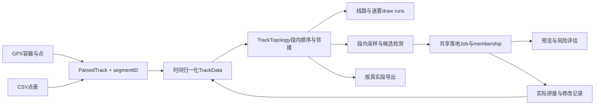

# 轨迹分段、编辑与异步发布

本设计由 Astra Ultra 在接手审查中制定，Sol Ultra 分流实现，主代理整合核验。**实现已整合，第4轮剩余复测及像素验收已完成；最终标签修复以新构建定向核验，11组既有UI没有重跑**；实际进度和失败证据见 [本轮闭环清单](../Tools/agents/records/2026-10-28-remediation/issues.md)。

## 两种顺序各负其责

轨迹仍以时间归一化的分列数组存储。时间排序适合筛选和播放，但相邻数组元素可能来自不同 GPX 段，不能据此认定两点之间有路径。`segmentID` 表示源路径身份，独立于用于显示来源的 `fileID`；`TrackTopology` 提供每段的路径顺序、反向排名和真实邻接。

例如时间数组为 `A0 B0 A1 B1`，真实边是 `A0→A1`、`B0→B1`，不能绘成 `A0→B0→A1→B1`。显示、测速、断档检测、补点和导出共用这一段身份。GPX 的 `trkseg`、`rte` 和不同 `trk` 分开，`wpt` 为孤立段；CSV 仍保留既有单文件平面点表及时间规范化语义。

单段保留隐式顺序快路，不额外建立百万级顺序/排名数组。多段按段生成紧凑索引与范围，局部工作流借用只读 view；不能为每个上下文重建完整 TrackData。GPX 导入仍是归一化，不承诺原 XML 节点、扩展和原节点顺序的无损往返。

## 编辑身份与替换范围

候选的唯一键是 `GapID(trackID, segment, a, b)`，不再仅用起始时间。同一时间的不同段候选、批次、预览和重取应独立。

落地 Job 的锚点必须属于同一段，其 membership 为该段路径排名范围。即使两个段在全局时间数组中的区间重叠，也只能替换所选段的成员；`keep` 必须是该集合的子集。同段重叠 Job 明确拒绝，不静默落地一个子集。预览计数、风险使用的实际点、最终拼接和删除记录都从同一计划派生。

所有补点、删除、撤销、部分/全部还原和临时 ParsedTrack 构造传播 segmentID。合成点、锚点和改时点的键包含 segment，避免同时间和坐标的另一段被误标。GPX 导出按真正段成员拆分；增量窗口也带段身份。CSV 保持单文件输出，逐点距离/速度/航向取本段前驱。

## 还原与状态发布

全部还原使用首次编辑前的精确会话基线，保留重复点、缺时间点、顺序及段列。部分还原按完整位值键的多重集和修改依赖处理；存在依赖或无法确定插入顺序时明确拒绝，用户可一起还原相关后续修改。不能用 Set 把重复观察压成一个点，也不能从当前已修改轨迹反推一个不完整基线。

后台工作开始时捕获文档修订、工作流 lane、源轨迹与文件集合；回主线程发布前核验。同一 lane 的较新请求替代旧请求，关闭/重载/编辑造成的旧回调不再覆盖当前状态。加载、派生统计、候选、路由/批次、预览和视频回调都需要适用的归属检查。取消协作与发布校验共同保证正确性，不能单靠 `Task.cancel()`。

## GPU资源与渲染

GPU 颜色由时间顺序和空间顺序两个不可变缓冲组成一次版本发布；两者都成功分配后才替换。已提交的 command 保留所用版本直到完成，不能在 CPU 原地改写仍可能被 GPU 读取的共享内存。

线路/迷雾分别缓存自己的软断点 draw runs，硬段边界永远保留。每个描述符16字节，GPU按段内顺序展开端点；多段用一次实例化 draw，箭头另一次，避免按每段提交 draw 或每帧构建全量边数组。单一 identity run 使用专用快速入口。LOD 保留不足 stride 的尾边，迷雾保留孤点；时间过滤不能复活被排除的端点。

线段按边的包围范围做视口裁剪，不能只检查端点是否落在视口内。文件显隐 mask 由 UI 传入；无 fileID 列表示隐式文件0，不能读取占位缓冲。球面继续显示点，本轮不增加球面路线模式。截图和视频沿用同一渲染入口。

Quick Look/缩略图按段断笔，孤立点可见；预览抽稀遵守全局点数预算，不能因每段强留两端而无限扩大。典型步长只采真实同段邻接，避免跨段距离干扰软断点判断。

## 改时出口链的覆盖修复

R4 真实生产链发现两处 `StaleRetime` 会保留近入口与近出口两组观察，却仅对 A 到最早保留点插值，落地后仍留109秒/约4.2公里、152秒/约6.9公里的缺口。风险0正确反映了原实际落地的小偏差，修复点在覆盖，不能用增加风险分掩盖。

既有投影、严格改时和速度守卫通过后，反向收集出口点时额外检查“当前真实位置→下一实际保留点或 B”的改后时间差和距离。触发现有 `GapDetector.isBreakStep` 就停止收更早的点；完整未覆盖前缀交给原路线插值。只保留不需要再插点的连续出口尾链，不扩大候选替换范围，也不改变非 stale 的逻辑。被替换的早期原点进入完整删除记录，能够精确还原。

原 `vMinRisk > 50` 和风险阈值保持。局部生产验证中，两例分别变为112合成+5改时/risk85、169合成+3改时/risk10，重检测不再有原窗口长缺口；其余98项分数不变。整合后的九个业务源码与真实生产202/202测试源逐hash一致；candidate84/97的落地、重检测与精确还原原始证据均已核对，另外98项风险保持。最终构建§6检查50个Valhalla候选全部high、有理由且默认排除，最低55，OSRM 50个无high。详见[业务实现验收](../Tools/agents/records/2026-10-28-remediation/coordinator/workflow-recovery-final-review.md)。

## 验收入口

- [Astra分段完整设计](../Tools/agents/records/2026-10-28-remediation/native/20261028T225215.126329Z_segment-topology-design_253f9196/output.md)：数据、编辑、渲染、性能契约与T01–T16。
- [Astra改时覆盖边界](../Tools/agents/records/2026-10-28-remediation/native/20261028T234643.994660Z_retime-design_3b343b89/output.md)：单出口、跳过坏点、缺时间、停车、稀疏、阈值、A侧裁退、交叠段和原点还原。
- `Tests/segments/core`：实际解析、拓扑、计算、GPX写出和预览；GPU隔离边界在其README说明。
- `Tests/segments/render`：实际Swift/Metal端点、离屏像素、旧shader反例、在途资源及规模测试；无设备退出77，不算通过。
- `Tests/segments/workflow`：生产业务202/202通过；独立Sol自写Store探针29/29及当时183项回归通过，已核对测试源归属与最终源hash。
- 最终指定构建三目标Release成功；11组UI已通过且恢复轮未重跑，合成114/114、自测51/51，125题两引擎各121/125的原四项基线保持，无新增回归。解锁后三语固定页脚实际像素通过；新发现的标签重叠已修复，生产字体几何24/24和新构建定向实际截图通过。测试后的窗口偏好已精确恢复原始字节；旧黑图和失败记录保留。详见[本轮验收报告](../Tools/agents/records/2026-10-28-remediation/coordinator/completion-report.md)。所有数值说明是对应夹具的证据，不是任意输入或全产品FPS保证。
